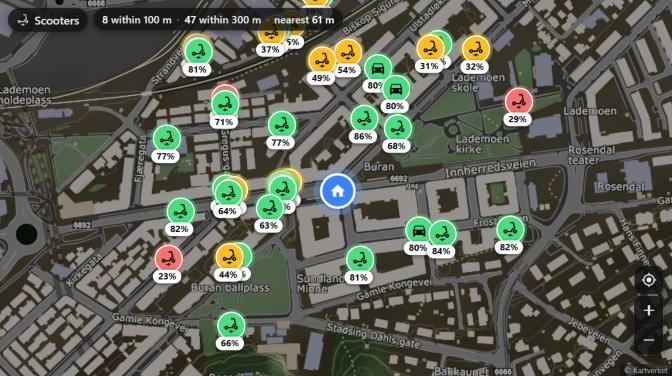
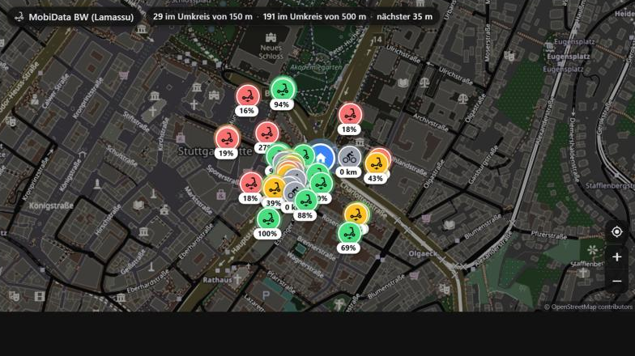

# Scooter Map Card

[](https://my.home-assistant.io/redirect/hacs_repository/?owner=andersgar&repository=scooter-map-card&category=plugin)
[](https://github.com/andersgar/scooter-map-card/actions/workflows/validate.yml)
[](https://github.com/andersgar/scooter-map-card/releases)

A Home Assistant dashboard card that shows the shared e-scooters, bikes and
cars parked around your home on a dark map, every marker labelled with its
battery. Tap a marker for range, distance and a link that opens the operator's
app on that exact vehicle.



- **Live.** Positions refresh every 30 s; markers move instead of flickering.
- **Battery at a glance.** Green ≥ 60 %, amber ≥ 30 %, red below. Operators
  that only publish range get an estimate from range ÷ max range.
- **No YAML needed.** Give the card a radius and it fetches vehicles itself:
  every operator in Norway through [Entur](https://developer.entur.org)
  (Ryde, Voi, Dott, Bolt, the city bikes, car sharing), every operator in
  Baden-Württemberg through MobiData BW, or **any GBFS feed** worldwide that
  allows browser access. Or read a Home Assistant sensor.
- **Filters** by operator and form factor (scooter, bike, cargo bike, moped, car).
- **Maps without API keys.** Kartverket topo (Norway) or OpenStreetMap, both
  run through a dark filter; any tile server via `tile_url`.
- Works as a small static tile, a full-width map, or inside a bubble-card
  pop-up. English / Norwegian / Swedish / German strings.



## Installation

### HACS (recommended)

1. HACS → ⋮ (top right) → **Custom repositories**.
2. Repository `https://github.com/andersgar/scooter-map-card`, type **Dashboard**, **Add**.
3. Search for *Scooter Map Card*, **Download**, reload the page when asked.

Or click the badge at the top of this page. HACS registers the dashboard
resource automatically (storage-mode dashboards). Leaflet is bundled; nothing
else to install.

### Manual

Download `scooter-map-card.js` from the [latest release](https://github.com/andersgar/scooter-map-card/releases)
into `config/www/scooter-map-card/` and add a dashboard resource
`/local/scooter-map-card/scooter-map-card.js` of type *JavaScript module*.

## Quick start (no sensors required)

Norway, scooters from Ryde only, centred on your Home Assistant home location:

```yaml
type: custom:scooter-map-card
title: Ryde
source:
  provider: entur
  range_m: 800
  operators: ["YRY:Operator:Ryde"]
  form_factors: ["SCOOTER_STANDING"]
zoom: 15
grid_options: { columns: full, rows: 6 }
```

Drop `operators:` to see every operator (Voi, Dott, Bolt, Ryde, city bikes,
car sharing) and `form_factors:` to include bikes and cars. Operator ids are
listed in [docs/providers.md](docs/providers.md).

Anywhere else, point the `gbfs` provider at an operator's auto-discovery file:

```yaml
source:
  provider: gbfs
  url: https://api.mobidata-bw.de/sharing/gbfs/v3/bolt_stuttgart/gbfs
  operator: Bolt
  lat: 48.7758
  lon: 9.1829
  range_m: 800
```

The [GBFS systems catalogue](https://github.com/MobilityData/gbfs/blob/master/systems.csv)
lists the discovery URL of ~1,500 systems. Feeds from Dott, Bird, Bolt,
nextbike, Lyft/Citi Bike and Urban Sharing allow browser access; Lime, Voi and
Donkey Republic do not, so for those use an aggregator (Entur, MobiData BW,
your own [Lamassu](https://github.com/entur/lamassu)) or the Home Assistant
sensor route. See [docs/providers.md](docs/providers.md).

## Configuration

### Card options

| Option | Default | Description |
|---|---|---|
| `entity` | – | Home Assistant entity whose `list` attribute holds vehicles (entity mode, see below). Either `entity` or `source` is required. |
| `source` | – | Fetch vehicles directly in the browser (see *Source options*). |
| `title` | localized "Scooters" | Text in the top-left chip. |
| `show_title` | `true` | |
| `show_stats` | `true` | Counts within `stats_radii` and the nearest distance. |
| `stats_radii` | `[100, 300]` | Metres. |
| `show_controls` | `true` | Zoom buttons and recenter. |
| `show_attribution` | `true` | Map credit. Kartverket and OpenStreetMap require it on visible maps; turn it off only on tiny tiles that open a bigger map. |
| `show_home` | `true` | Blue home pin. |
| `interactive` | `true` | `false` = static tile: no drag or zoom, no marker pop-ups (use with `tap_action`). |
| `zoom` | `15` | |
| `max_markers` | `40` | Nearest N vehicles drawn. |
| `tiles` | `auto` | `auto` (Kartverket in Norway, else OSM dark), `dark`, `light`, `osm`, `kartverket-dark`, `kartverket`, `kartverket-topo`, `kartverket-invert`. |
| `tile_url`, `tile_attribution`, `tile_filter` | – | Your own tile server (`{z}/{x}/{y}` template) with optional CSS filter. |
| `brightness` | `1` | Extra brightness multiplier on the tiles (0.8–1.4). |
| `link` | `android` | Which rental link the pop-up offers: `android`, `ios`, `web`, `none`. |
| `operator_names` | `{}` | Operator id → short label for the pop-up. |
| `home_lat`, `home_lon`, `home_label` | HA home | Override the centre; label used in "N m from home". |
| `height` | – | Minimum height (px number or CSS length) for masonry views and pop-ups. |
| `language` | HA user language | `en`, `nb`, `sv`, `de`. |
| `tap_action` | – | Standard HA action, plus `recenter`. Marker pop-ups and controls still work when `interactive` is on. |
| `grid_options` | `{ columns: 12, rows: 5 }` | Size in sections views. Bubble-card pop-ups size cards on the same 56 px row grid. |

### Source options

| Option | Default | Description |
|---|---|---|
| `provider` | `entur` | `entur` (any [Lamassu](https://github.com/entur/lamassu) GraphQL endpoint), `gbfs`, or a provider registered at runtime ([docs/providers.md](docs/providers.md)). |
| `url` | provider default | Entur: another Lamassu instance, e.g. `https://api.mobidata-bw.de/sharing/graphql`. GBFS: the `gbfs.json` auto-discovery URL, or a `vehicle_status` / `free_bike_status` URL directly. |
| `lat`, `lon` | HA home | Centre of the search. |
| `range_m` | `800` | Radius in metres. |
| `count` | `300` | Maximum vehicles fetched. |
| `refresh` | `30` | Seconds between fetches. Cards with identical sources share one fetch; polling pauses while the tab is hidden. |
| `operators` | all | Entur/Lamassu: operator ids such as `YRY:Operator:Ryde`, `YVO:Operator:voi`. |
| `form_factors` | all | `SCOOTER_STANDING`, `SCOOTER_SEATED`, `BICYCLE`, `CARGO_BICYCLE`, `MOPED`, `CAR`, `OTHER`. |
| `include_reserved`, `include_disabled` | `false` | |
| `operator` | – | GBFS: label for the pop-up (feeds carry no operator name per vehicle). |
| `language` | – | GBFS 2.x discovery files are keyed by language. |
| `max_range_m` | – | GBFS: fallback max range for the battery estimate when the feed publishes neither fuel percent nor a vehicle type max range. |
| `client_name` | `homeassistant-scooter-map-card` | Sent as `ET-Client-Name` to Entur, as they ask. |

### Entity mode

```yaml
type: custom:scooter-map-card
entity: sensor.ryde_list
```

The sensor's `list` attribute holds vehicles sorted by distance, shape
documented in [docs/home-assistant-sensors.md](docs/home-assistant-sensors.md).
Ready-made packages: [Entur](homeassistant/packages/scooter_map_entur.yaml)
and [any GBFS feed](homeassistant/packages/scooter_map_gbfs.yaml), both a
`rest` sensor plus template sensors that also give you "nearest scooter" and
"scooters within 300 m" entities for automations. Fetching server-side also
sidesteps CORS for feeds that block browsers.

## Examples

**Small static tile that opens a pop-up:**

```yaml
type: custom:scooter-map-card
entity: sensor.ryde_list
interactive: false
show_stats: false
show_controls: false
show_attribution: false
tap_action: { action: navigate, navigation_path: "#scooter_map" }
grid_options: { columns: 6, rows: 4 }
```

**Full map in a bubble-card pop-up** (`hash: "#scooter_map"`, `width_desktop: 96vw`):

```yaml
type: custom:scooter-map-card
entity: sensor.ryde_list
zoom: 17
grid_options: { columns: full, rows: 13 }
```

**Oslo city bikes and scooters, bikes included:**

```yaml
source:
  provider: entur
  lat: 59.9111
  lon: 10.7528
  range_m: 500
  form_factors: ["SCOOTER_STANDING", "BICYCLE"]
stats_radii: [150, 500]
```

**Every operator in Stuttgart through MobiData BW's Lamassu (same API as Entur):**

```yaml
language: de
source:
  provider: entur
  url: https://api.mobidata-bw.de/sharing/graphql
  lat: 48.7758
  lon: 9.1829
  range_m: 600
```

## Notes on map tiles

OpenStreetMap's public tile servers have a [usage policy](https://operations.osmfoundation.org/policies/tiles/)
and have been seen blocking some Home Assistant domains; Kartverket only covers
Norway. For anything heavier than a home dashboard, or if tiles stop loading,
set `tile_url` to a provider you have an agreement with.

## Development

```bash
npm install
npm run build        # bundles src/ + Leaflet into dist/scooter-map-card.js
npm run watch
npm run dev          # static server on :8765, open /dev/ for the test harness
```

`dev/index.html` renders the card from a fixture (entity mode) and live from
Entur, MobiData BW and a GBFS feed (source mode). `dist/` is committed so HACS
can install straight from the default branch; releases attach the same file.

The element is also registered as `custom:ryde-map-card` for dashboards built
with the original Ryde-only version of this card.

## Credits and data licences

Vehicle data from [Entur](https://developer.entur.org) (NLOD),
[MobiData BW](https://mobidata-bw.de) (DL-DE-BY 2.0) and the operators' GBFS
feeds. Maps © [Kartverket](https://www.kartverket.no) (CC BY 4.0) and
© [OpenStreetMap contributors](https://www.openstreetmap.org/copyright).
Built on [Leaflet](https://leafletjs.com) (BSD-2-Clause). Card by Anders
Garberg, MIT licence.
